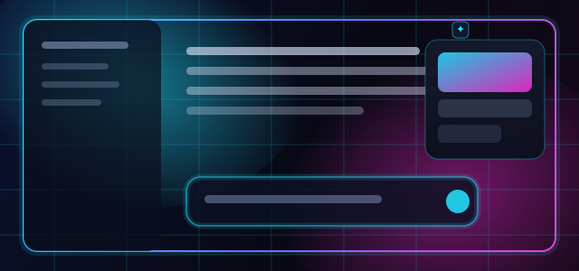

# 霓虹主题引擎

给 DSH Web 界面换上一整套动态视觉：会呼吸的霓虹窗口边框、发光的输入框光环、十款纯代码绘制的动态背景，以及一个能实时预览的免费壁纸库。

## 主要功能

**十款皮肤 · 五个分类**
每个分类下都有多款配色各异的动态背景：赛博、星海、樱花、极光、深海等。全部由 CSS 渐变与动画绘制，不随包分发任何图片，任意分辨率都清晰。

**三种切换方式**
手动挑选、在当前分类里按时自动轮换、或按时间段自动切换（清晨 / 白天 / 黄昏 / 夜晚各有一套推荐皮肤）。

**壁纸库**
- 图片：Wallhaven（精选 / 人物 / 卡通 / 动物 / 动漫 / 赛博 / 太空 / 风景 / 灌篮壁纸 / 樱木花道）、Bing 每日一图、Picsum 随机
- 动态：Mixkit 十二类素材（动物 / 人物 / 卡通 / 运动 / 水 / 烈火 / 科技 / 旅行 / 美食 / 城市 / 太空 / 混合）
- 番剧：Sakugabooru 二十四部作品，按社区评分排序的高光作画片段
- 每页 40 条（素材每页 12 条），可一直「加载更多」；勾选多条可组成**播放列表**自动轮播（上限 50 条）

**细节调节**
壁纸亮度（显示实际倍率）、主界面不透明度、扫描光开关、边框呼吸速度、输入框光环开关、静默模式（一键停掉所有动画，排查卡顿用）。

## 使用

- 会话标题右侧的 **✦ 霓虹主题** 按钮 → 面板直接展开
- 或 **设置 → 通用 → 霓虹主题引擎 → 打开面板**

面板分三个标签：皮肤、图片、动态视频。

## 数据与网络

- 皮肤、壁纸、播放列表写入宿主文件 `$DSH_HOME/neon-theme-settings.json`，换端口或重启 DSH 后依然保留
- 壁纸与视频经本机代理取回并缓存到 `$DSH_HOME/neon-theme-cache`（上限 80 个文件或 1.2 GB，按最旧清理）
- 代理只允许白名单域名（wallhaven / bing / picsum / unsplash / mixkit / sakugabooru），只接受 GET/HEAD，不做任意转发
- 不收集遥测；除取壁纸与视频外不向外发送任何数据

## 兼容性

需要带 Web 服务器的 DSH（桌面版或 `dsh web`），因为壁纸代理与设置持久化跑在 Host 侧。与其它同时改写背景层的主题插件（如 `dsh-anime-theme`）会互相覆盖，建议只启用一个。

## 许可

代码以 MIT 开源。壁纸与视频素材版权归各站点与原作者所有，插件只在本机取回缓存用于个人界面装饰，不随仓库分发。

作者：Andy Zhu · [GitHub](https://github.com/zmq6931/dsh-neon-theme-ad)
